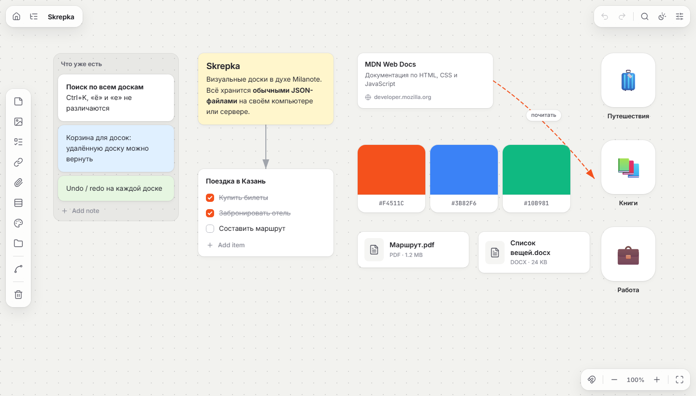
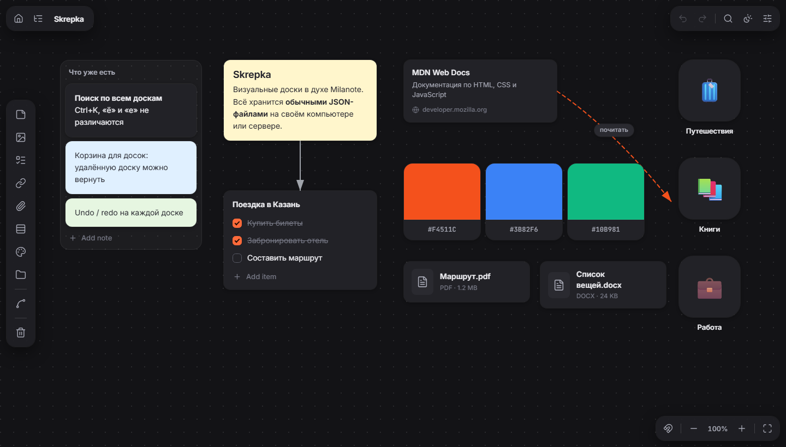
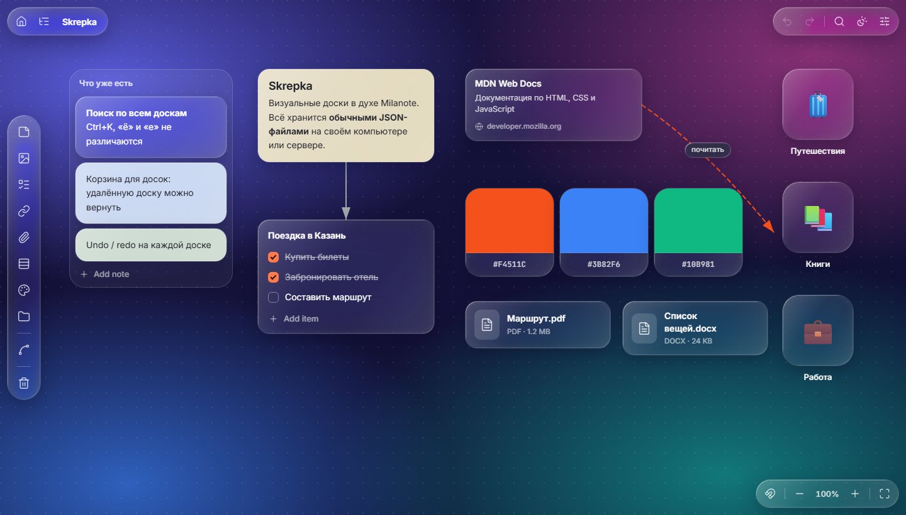

# Skrepka

Визуальные доски в духе Milanote, которые работают на своём компьютере или сервере. На бесконечном холсте можно раскладывать:
- заметки с форматированием, картинки, файлы, списки дел;
- ссылки с превью, колонки и цветовые образцы;
- вложенные доски и стрелки между карточками.

Есть поиск по всем доскам, корзина, отмена действий и три темы оформления. Базы данных нет: каждая доска хранится отдельным JSON-файлом.

<p align="center">
  
</p>

<p align="center">
  
  &nbsp;
  
</p>

## Возможности

- **Карточки:** заметки (жирный, курсив, заголовки, списки, цитаты, код, цвет текста и подсветка), картинки с подписью, файлы любого типа (docx, pdf, txt…) с размером и скачиванием, списки дел, ссылки с заголовком и картинкой со страницы, колонки, цветовые образцы.
- **Вложенные доски.** У каждой доски свой адрес, поэтому работают обновление страницы, закладки и кнопка «Назад». Есть хлебные крошки и дерево всех досок.
- **Стрелки** между карточками: цвет, толщина, пунктир, подпись. Перетаскиванием можно изогнуть.
- **Порядок на доске:** прилипание к краям и центрам соседних карточек с направляющими, привязка к сетке, выравнивание и равные промежутки для выделенных карточек.
- **Буфер обмена и перетаскивание:** карточки копируются между досками вместе со стрелками. Вставленная или перетащенная картинка, файл, ссылка или текст сами становятся карточками.
- **Поиск** (`Ctrl+K`) по названиям досок, тексту карточек, комментариям и подписям стрелок, без учёта регистра и разницы «ё» / «е».
- **Корзина:** удалённая доска уходит туда вместе со вложенными, её можно вернуть.
- **Undo / redo** для каждой доски, комментарии к карточкам, экспорт и импорт доски в JSON.
- **Темы:** светлая, тёмная и стеклянная (с выбором обоев). Управление пальцами на тачскрине: перемещение и масштаб.
- **Пароль** на вход, если сервер открыт в интернет.

## Стек

| | |
|---|---|
| Сервер | Node.js 20+, Express 4, multer (загрузка файлов) |
| Клиент | чистый JavaScript (ES-модули), HTML и CSS, без фреймворков и сборки |
| Хранение | JSON-файлы на диске, загруженные файлы рядом в `data/media` |
| Тесты | встроенный `node:test` |
| Запуск на сервере | Docker, docker compose |

## Как устроено

```
server.js            REST API: доски, корзина, поиск, загрузка файлов, превью ссылок
lib/link-preview.js  загрузка страницы для превью ссылки (с защитой, см. ниже)
public/
  index.html         единственная страница
  js/app.js          состояние, отрисовка доски, сохранение, навигация, панели
  js/elements.js     карточки каждого типа
  js/interactions.js перетаскивание, изменение размера, выделение рамкой
  js/connections.js  стрелки
  js/columns.js      колонки
  js/arrange.js      прилипание, сетка, выравнивание
  js/history.js      undo / redo
  js/clipboard.js    копирование и вставка
  js/uploads.js      загрузка: картинка становится карточкой-картинкой, остальное карточкой-файлом
  js/search.js, trash.js, tree.js, comments.js, toast.js
test/                тесты сервера и превью ссылок
```

- **Сохранение.** Клиент держит открытую доску в памяти и после правок отправляет её целиком одним `PUT` с задержкой 500 мс. Пока идёт одно сохранение, следующее ждёт. Неудачное повторяется через 5 секунд. При скрытии вкладки несохранённое отправляется сразу.
- **Запись на диск атомарная:** сначала во временный файл, потом переименование. Если процесс упадёт посреди записи, останется предыдущая версия доски, а не обрезанный JSON.
- **Undo / redo** работает на снимках. Через мгновение после последней правки доска сравнивается с предыдущим снимком, и если она изменилась, снимок становится шагом отмены. Серия нажатий клавиш или удаление нескольких карточек — один шаг.
- **Какие доски существуют**, определяет сервер: он обходит в ширину карточки-доски, начиная с главной. Доска, на которую не ведёт ни одна карточка, недоступна. Из этого же обхода строятся хлебные крошки, дерево и поиск.
- **Корзина.** При окончательном удалении стираются и вложенные доски, если на них больше не ссылается ни одна другая доска, живая или в корзине.

## Безопасность

Приложение рассчитано на одного владельца, но его можно открыть в интернет, поэтому:

- **Пароль:** HTTP Basic, пароль сравнивается за постоянное время. После 10 неверных попыток за 15 минут адрес получает `429`.
- **Загрузки.** Картинки показываются на доске, и их расширение берётся из MIME-типа, а не из имени. Остальные файлы отдаются только на скачивание (`Content-Disposition: attachment`). Всё из `/media` отдаётся с `Content-Security-Policy: sandbox` и `nosniff`, поэтому ни загруженный HTML, ни открытый напрямую SVG не выполнят скрипт с нашего адреса.
- **HTML заметок очищается при отрисовке:** остаются только теги и стили, которые создаёт сам редактор. Это важно, потому что карточки можно вставить из буфера обмена (туда может написать любая веб-страница) или импортировать из файла.
- **Ссылки** открываются только с `http(s)` и с `noopener`, а файлы скачиваются только из своих же загрузок.
- **Превью ссылок:** сервер скачивает страницу по присланному адресу, поэтому:
  - разрешены только `http(s)` и только публичные адреса, без localhost, домашней сети и `169.254.169.254`;
  - адрес проверяется при каждом соединении, включая редиректы, так что DNS-rebinding не помогает;
  - не больше 3 редиректов, 512 КБ и 5 секунд.
- Неверный id доски, битый JSON или слишком большой файл получают JSON-ошибку, а не трассировку стека.

## Запуск

Нужен [Node.js](https://nodejs.org) 20 или новее.

```bash
npm install
npm start      # http://localhost:3000
npm test       # тесты
```

| Переменная | По умолчанию | Что делает |
| --- | --- | --- |
| `PORT` | `3000` | Порт сервера |
| `DATA_DIR` | `./data` | Папка с досками и загруженными файлами, создаётся сама |
| `SKREPKA_PASSWORD` | не задан | Если задан, браузер спросит пароль (логин любой) |
| `TRUST_PROXY` | `loopback` | Каким прокси верить в `X-Forwarded-For`, нужно для лимита попыток пароля за обратным прокси ([значения](https://expressjs.com/en/guide/behind-proxies.html)) |

### Данные и бэкап

- `data/boards/*.json` — доски (`__home__.json` — главная);
- `data/media/` — загруженные картинки и файлы;
- `data/trash/*.json` — доски в корзине.

Для бэкапа или переезда достаточно скопировать папку `data`.

<details>
<summary><b>Управление</b></summary>

| Действие | Как |
| --- | --- |
| Добавить карточку | Кнопки на панели слева; картинки и файлы можно перетащить из проводника |
| Вставить из буфера | `Ctrl+V`: картинка или скриншот станет карточкой-картинкой, скопированный файл — карточкой-файлом, ссылка — карточкой-ссылкой, текст — заметкой. Появляются под курсором |
| Копировать / вырезать карточки | `Ctrl+C` / `Ctrl+X`, затем `Ctrl+V` на этой или другой доске. Карточки-доски не копируются |
| Отменить / вернуть | `Ctrl+Z` / `Ctrl+Shift+Z` (или `Ctrl+Y`) |
| Поиск | `Ctrl+K` или лупа справа вверху. Без запроса показывает список досок для быстрого перехода |
| Редактировать текст | Двойной клик по карточке |
| Двигать холст | Перетащить за пустое место; поверх карточек — `Пробел` + перетаскивание или средняя кнопка мыши |
| Масштаб | Колесо мыши или щипок на тачпаде; клик по процентам сбрасывает на 100% |
| Выделить несколько | `Shift` + рамка по пустому месту, `Shift`+клик, `Ctrl+A` |
| Дублировать / удалить | `Ctrl+D` / `Delete` |
| Ровно расставить | При перетаскивании карточка прилипает к соседним, `Alt` — свободно. Кнопка с магнитом включает привязку к сетке |
| Выровнять несколько | Выделите две карточки или больше, сверху появится панель выравнивания |
| Колонки | Карточку можно перетащить в колонку на нужное место и вытащить обратно. При удалении колонки её карточки остаются на доске |
| Комментарии | Правый клик по карточке → Comment. `Enter` — добавить, `Shift+Enter` — новая строка |
| Соединить карточки | Инструмент Line, затем клик по первой и по второй карточке; `Esc` — выйти |
| Открыть вложенную доску | Двойной клик по её иконке |
| Скачать файл | Двойной клик по карточке-файлу или кнопка в её углу |
| Цвет, порядок слоёв, иконка доски | Правый клик по карточке |

</details>

## Доступ с других устройств

- **В домашней сети** работает сразу: при запуске сервер печатает адреса вида `http://192.168.x.x:3000`. Если страница не открывается, разрешите порт в брандмауэре Windows (PowerShell от администратора):

  ```powershell
  New-NetFirewallRule -DisplayName "Skrepka" -Direction Inbound -Protocol TCP -LocalPort 3000 -Action Allow -Profile Private
  ```

- **Откуда угодно через [Tailscale](https://tailscale.com).** Устройства объединяются в приватную сеть, наружу ничего не открывается. Сервер доступен по `http://<имя-компьютера>:3000`.
- **На отдельном сервере через Docker.** Доски хранятся в `./data` рядом с `docker-compose.yml`:

  ```bash
  echo "SKREPKA_PASSWORD=длинный-пароль" > .env
  docker compose up -d --build
  ```

  Открывать сервер в интернет стоит только через HTTPS, потому что без него пароль передаётся открытым текстом. Проще всего поставить перед приложением [Caddy](https://caddyserver.com), он сам получает сертификат:

  ```
  notes.example.com {
      reverse_proxy localhost:3000
  }
  ```

  В этом случае в `docker-compose.yml` замените `"3000:3000"` на `"127.0.0.1:3000:3000"`. А чтобы лимит попыток пароля видел настоящие адреса клиентов, добавьте `TRUST_PROXY` с адресом прокси (для Docker это обычно `172.16.0.0/12`).

Бесплатные тарифы облачных платформ обычно стирают файлы при перезапуске. Там нужен постоянный диск, подключённый к `DATA_DIR`.

## Ограничения

- **Нет синхронизации в реальном времени.** Доска сохраняется целиком, побеждает последнее сохранение. Если одна доска открыта на двух устройствах сразу, правки одного затрут правки другого.
- **На телефоне** можно смотреть доски и двигать холст, но перетаскивать карточки пальцем пока нельзя.
- **Стеклянная тема** нагружает видеокарту: на досках с сотнями карточек лучше выбрать светлую или тёмную.
- **Один пароль на всё**, без пользователей и ролей.
- Загруженные файлы не удаляются вместе с карточками: один файл может использоваться в нескольких местах.
